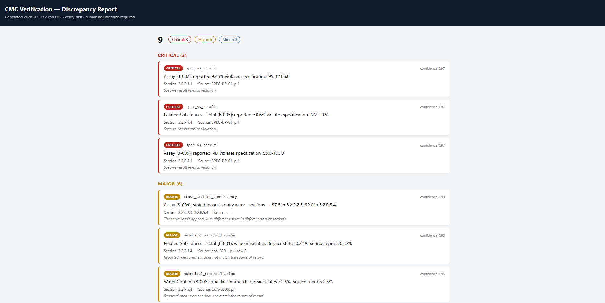

# CMC Verifier

**Source-grounded, multi-agent verification for pharmaceutical CMC documentation.**

A verify-first pipeline that reads a Module 3 (Chemistry, Manufacturing & Controls) dossier and its underlying source data — Certificates of Analysis, specifications, batch records — and flags every discrepancy for a qualified human to adjudicate. It does not author, and it does not decide: it catches the errors that turn into regulatory deficiencies, and it proves every flag against a source.

> Why this is hard, and why it matters: in a GxP setting the bottleneck isn't the science, it's traceability and data integrity. A single fabricated or mistyped value in a submission can trigger a deficiency letter and months of delay. So the useful posture isn't "AI decides" — it's "AI flags, with evidence, and a human signs off." That constraint shapes the entire architecture: every output traces to a source, nothing is resolved automatically, and runs are reproducible.

<!-- Add your screenshot here: save a picture of the generated report.html to docs/report.png -->


## What it does

Given a dossier and a folder of source documents, it produces a ranked discrepancy report. On the bundled synthetic golden dataset it catches **9 discrepancies** across four independent checks:

| Check | Catches |
|---|---|
| `numerical_reconciliation` | Reported values that disagree with the source — including qualifier (`<`, `>`) and result-type (`ND` vs numeric) mismatches |
| `spec_vs_result` | Results outside specification, with pass / violation / **indeterminate** verdicts (a `<0.6` against a `NMT 0.5` limit can't be confirmed either way) |
| `traceability` | Quantitative claims with no matching source record |
| `cross_section_consistency` | The same analyte+batch stated differently in two CTD sections |

Three more checks (`unit_nomenclature`, `completeness_ctd`, `stability_trend`) are scaffolded as the next build blocks.

Source documents are ingested through format-specific adapters that all feed one shared normalization layer:

- **CSV** — handles real-world mess: preambles, buried headers, embedded units (`99.2 %`), padded names, category sub-headers, footers, multi-batch files, analyte aliases, and non-numeric results.
- **PDF** — bordered tables via ruling-line detection, borderless tables via text-alignment fallback (pdfplumber).
- **JSON** — structured facts.

Every extracted fact carries provenance (document, page, row), so every flag can point back to exactly where the value came from.

## Quickstart (~60 seconds)

```bash
git clone https://github.com/hrishikeshmore2210/cmc-verifier.git
cd cmc-verifier

python -m venv .venv
source .venv/bin/activate          # macOS/Linux
# .venv\Scripts\Activate.ps1       # Windows PowerShell

pip install -r requirements.txt

python run.py --report             # runs the pipeline, writes report.html
```

Open `report.html` in a browser to see the discrepancies grouped by severity, each with its source citation. Then run the eval suite:

```bash
pytest -q
```

> The PDF fixtures are committed. To regenerate them you need `reportlab` (a dev-only dependency): `pip install reportlab && python scripts/make_sample_pdf.py && python scripts/make_borderless_pdf.py`.

## Architecture

A LangGraph state graph: a shared ingestion/normalization spine, a parallel fan-out of check agents, a critic that dedupes and tallies flags by severity, and a human-in-the-loop review step.

```
START → ingest → extract_claims → ground
      → [ numerical_reconciliation | spec_vs_result | traceability |
          cross_section_consistency | (3 stubs) ]   ← run in parallel
      → critic → human_review → END
```

The design deliberately separates **extraction** (get rows-and-cells out of a document) from **normalization** (units, qualifiers, aliases, spec parsing). Adding a new source format means writing one small adapter that produces rows-and-cells; everything downstream is reused. See [ARCHITECTURE.md](ARCHITECTURE.md) for the full design, the build/seam markers, and the roadmap toward a phase-2 authoring module.

## Design principles

- **Flag, never decide.** The system surfaces discrepancies with evidence; a qualified human adjudicates. Low model influence keeps it cheap for a regulated buyer to validate.
- **No ungrounded claim.** Every fact and flag carries a source pointer, enforced in code.
- **Reproducible by construction.** Deterministic checks in code; the pipeline is currently fully deterministic (LLM-based extraction is on the roadmap).
- **Eval-driven.** A golden dataset with injected errors and answer keys measures both extraction accuracy and check accuracy — every capability ships with its own proof.

## Testing

```bash
pytest -q
```

**85 tests**, covering the graph end-to-end, per-check verdict truth tables, and extraction accuracy. Extraction runs at **1.0 precision/recall** against the golden CoA fixtures (CSV, bordered PDF, and borderless PDF), and the graph asserts the exact set of 9 known discrepancies with no false positives on the clean claims.

## Tech

Python 3.10+ · [LangGraph](https://github.com/langchain-ai/langgraph) · Pydantic v2 · pdfplumber · pytest

## Status & scope

This is a working prototype built to demonstrate production-grade AI-engineering patterns for a regulated domain. It runs on **synthetic data** and is **not validated for production GxP use** — it's a design-partner and portfolio artifact, not a certified system. Known frontiers: scanned/image PDFs (no text layer, needs OCR), a real human-in-the-loop interrupt with a persisted audit trail, and the phase-2 authoring module described in the architecture doc.